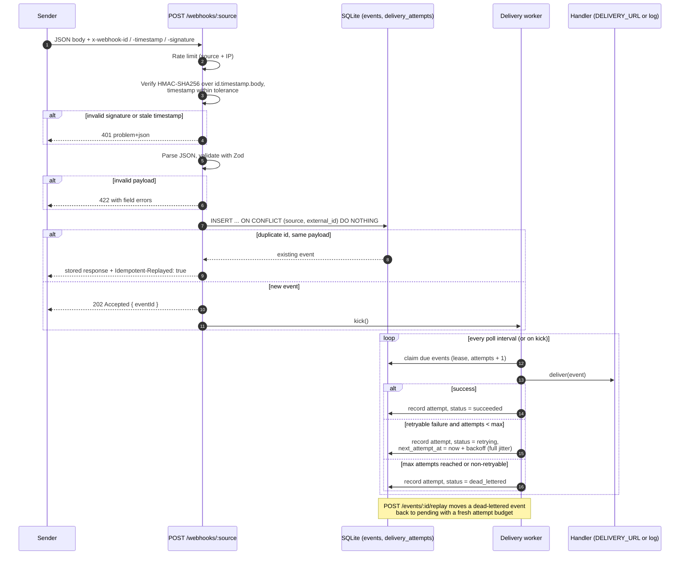

# express-webhook-service

A webhook ingestion service that verifies signed deliveries, de-duplicates them, and processes each event reliably with retries, exponential backoff and a dead-letter queue.

[](https://github.com/eshginfarzali/express-webhook-service/actions/workflows/ci.yml)
[](LICENSE)


## Features

- **HMAC-SHA256 signature verification** over the raw request body, compared in constant time
  (`crypto.timingSafeEqual`). The event id and timestamp are part of the signed content.
- **Replay protection**: the `x-webhook-timestamp` header must be within a configurable tolerance
  window (default ±300 s) of server time.
- **Payload validation with Zod**, returning field-level errors as `422` problem details.
- **Idempotent ingestion**: `(source, x-webhook-id)` is unique. A duplicate delivery returns the
  originally stored response with `Idempotent-Replayed: true` and is not processed again; reusing an
  id with a different payload returns `409`.
- **Reliable processing**: events are persisted first (`202 Accepted`), then delivered by a
  background worker with **exponential backoff + full jitter**, a max-attempts limit and a
  **dead-letter** state. Non-retryable failures (e.g. a downstream `400`) are dead-lettered
  immediately.
- **Crash recovery**: workers lease events while processing; an event whose lease expires (process
  died mid-delivery) is picked up again.
- **Admin API** (bearer token) to list and inspect events with their delivery attempts, and to
  **replay** dead-lettered events.
- **Rate limiting** per `source + client IP`, **helmet** security headers, **pino** structured JSON
  logs with **request ids** (`x-request-id` is accepted or generated, and echoed), RFC 9457
  `application/problem+json` errors.
- **Health endpoint** that checks the database, and **graceful shutdown** on `SIGTERM`/`SIGINT`
  (stop accepting connections, finish in-flight deliveries, close the database).
- **Configuration via environment variables**, validated with Zod at startup.
- Multi-stage, non-root **Docker** image and `docker-compose.yml`; **GitHub Actions** CI.

## Tech stack

| Concern     | Choice                                                         |
| ----------- | -------------------------------------------------------------- |
| Runtime     | Node.js 22, TypeScript (strict, ESM, `NodeNext`)               |
| HTTP        | Express 5, helmet, express-rate-limit                          |
| Validation  | Zod 4 (env config, payloads, query parameters)                 |
| Persistence | SQLite via better-sqlite3 (WAL mode, schema migrations)        |
| Logging     | pino + pino-http                                               |
| Testing     | Vitest (fake timers, V8 coverage) + supertest                  |
| Tooling     | ESLint (typescript-eslint `strictTypeChecked`), Prettier       |
| Delivery    | Docker (multi-stage, non-root), Docker Compose, GitHub Actions |

## Architecture



**Event lifecycle:** `pending → processing → succeeded`, or `processing → retrying → processing → …`
until `dead_lettered`. Replay moves `dead_lettered → pending`.

**Retry schedule.** After failed attempt _n_, the next attempt is delayed by
`random(0, min(RETRY_MAX_DELAY_MS, RETRY_BASE_DELAY_MS × 2^(n−1)))` ("full jitter"). With the
defaults (base 1 s, cap 5 min, 6 attempts) the upper bounds are 1 s, 2 s, 4 s, 8 s, 16 s. The math
lives in [`src/retry/backoff.ts`](src/retry/backoff.ts) as pure functions (clock and random source
are injected), which makes the schedule unit-testable.

**Delivery semantics.** Processing is _at-least-once_: if the process crashes after the handler
succeeded but before the result is recorded, the event is delivered again once its lease expires.
The HTTP forwarder therefore sends the internal event id as an `Idempotency-Key` header so the
downstream service can de-duplicate.

**Persistence.** A single SQLite file (`DATABASE_PATH`) holds two tables, `events` and
`delivery_attempts`; schema migrations run automatically on startup (tracked with
`PRAGMA user_version`). better-sqlite3 is synchronous, which makes each repository call atomic with
respect to the event loop; the claim step is a single `UPDATE … RETURNING` statement. This keeps the
service dependency-free to run, but it is a single-node design (see [Roadmap](#roadmap)).

**Processing.** If `DELIVERY_URL` is set, each event is `POST`ed there as JSON (2xx = success;
network errors, timeouts, `408`, `425`, `429` and `5xx` are retried; other `4xx` are dead-lettered
immediately). If it is not set, a log-only handler marks events as processed, which is useful for
local experiments.

### Project layout

```
src/
  app.ts                 Express app: middleware, routes, error handling
  service.ts             Wires DB, worker and HTTP server; graceful shutdown
  server.ts              Process entry point (config, signals)
  config/index.ts        Zod-validated environment configuration
  db/database.ts         SQLite connection + migrations
  events/                Event repository, types, admin router
  webhooks/              Signature verification, payload schema, ingestion router
  delivery/              Delivery worker, HTTP forwarder / log handler
  retry/backoff.ts       Pure backoff + retry decision functions
  http/                  Problem details, bearer auth, rate limiter
scripts/
  sign-webhook.ts        Signs (and optionally sends) a sample webhook
  docker-smoke.sh        Starts the image and waits for /health (used in CI)
test/
  unit/                  Backoff math, signatures, config, forwarder, logger
  integration/           HTTP API, worker with fake timers, full service lifecycle
```

## Getting started

Requirements: Node.js 22+ and npm.

```bash
npm ci
cp .env.example .env
```

Edit `.env` and set at least `WEBHOOK_SECRETS` and `ADMIN_API_TOKEN` (for example with
`openssl rand -hex 32`). `WEBHOOK_SECRETS` is a comma-separated list of `source:secret` pairs; each
source gets its own endpoint `POST /webhooks/<source>`.

```bash
# Node does not read .env by itself; --env-file is built into Node 22.
node --env-file=.env --import tsx src/server.ts   # or: npm run build && node --env-file=.env dist/server.js
```

The service listens on port **3300** by default (`PORT`).

### Docker

```bash
cp .env.example .env   # set WEBHOOK_SECRETS and ADMIN_API_TOKEN
docker compose up --build
curl http://localhost:3300/health
```

The host port is configurable with `HOST_PORT` (default `3300`). The container runs as the
unprivileged `node` user with a read-only root filesystem; the SQLite database lives in the
`webhook-data` volume. `docker compose down -v` removes the container and the volume.

### Configuration

All variables are validated at startup; invalid values abort the process with a list of problems.
See [`.env.example`](.env.example) for the full list. The most important ones:

| Variable                       | Default              | Description                                      |
| ------------------------------ | -------------------- | ------------------------------------------------ |
| `PORT`                         | `3300`               | HTTP port                                        |
| `WEBHOOK_SECRETS`              | (required)           | `source:secret` pairs, secrets ≥ 16 chars        |
| `ADMIN_API_TOKEN`              | (required)           | Bearer token for `/events` (≥ 24 chars)          |
| `DATABASE_PATH`                | `./data/webhooks.db` | SQLite file (directory is created)               |
| `SIGNATURE_TOLERANCE_SECONDS`  | `300`                | Allowed clock skew for `x-webhook-timestamp`     |
| `RATE_LIMIT_WINDOW_MS` / `MAX` | `60000` / `120`      | Requests per window per source + client IP       |
| `RETRY_MAX_ATTEMPTS`           | `6`                  | Total attempts before dead-lettering             |
| `RETRY_BASE_DELAY_MS`          | `1000`               | First retry delay (before jitter)                |
| `RETRY_MAX_DELAY_MS`           | `300000`             | Cap for any single delay                         |
| `DELIVERY_URL`                 | (unset)              | Forward events here; if unset, events are logged |
| `TRUST_PROXY`                  | `0`                  | Reverse-proxy hops to trust for client IPs       |

## Signing a webhook

Signature scheme:

```
signed_content = "<x-webhook-id>.<x-webhook-timestamp>.<raw body>"
x-webhook-signature: v1=<hex(HMAC-SHA256(secret, signed_content))>
```

`x-webhook-timestamp` is Unix time in **seconds**. Binding the id and timestamp into the signature
means neither can be changed without invalidating it.

**With the bundled script** (uses the same code as the server):

```bash
# print a ready-to-run curl command
npm run sign -- --source billing --secret "<billing secret>"

# or send it directly
npm run sign -- --source billing --secret "<billing secret>" --send
```

Options: `--url` (default `http://localhost:3300`), `--source`, `--secret` (or `WEBHOOK_SECRET`
env var), `--id`, `--type`, `--data` (JSON object), `--send`.

**With plain shell tools** (`openssl` + `curl`):

```bash
SECRET='<billing secret>'
ID="evt_$(date +%s)"
TS="$(date +%s)"
BODY='{"type":"invoice.paid","occurred_at":"2026-10-24T10:00:00Z","data":{"invoiceId":"inv_42"}}'
SIG="$(printf '%s' "${ID}.${TS}.${BODY}" | openssl dgst -sha256 -hmac "$SECRET" -hex | sed 's/^.* //')"

curl -i -X POST http://localhost:3300/webhooks/billing \
  -H 'content-type: application/json' \
  -H "x-webhook-id: ${ID}" \
  -H "x-webhook-timestamp: ${TS}" \
  -H "x-webhook-signature: v1=${SIG}" \
  --data "$BODY"
```

Running the same `curl` again (same id and body) returns the stored `202` response with
`Idempotent-Replayed: true`.

## Scripts

| Script                  | Description                                    |
| ----------------------- | ---------------------------------------------- |
| `npm run dev`           | Start with `tsx watch` (reload on change)      |
| `npm run build`         | Compile TypeScript to `dist/`                  |
| `npm start`             | Run the compiled server (`dist/server.js`)     |
| `npm run lint`          | ESLint, zero warnings allowed                  |
| `npm run format`        | Format with Prettier                           |
| `npm run format:check`  | Check formatting                               |
| `npm run typecheck`     | `tsc --noEmit` over sources, tests and scripts |
| `npm test`              | Run the test suite once                        |
| `npm run test:watch`    | Vitest in watch mode                           |
| `npm run test:coverage` | Tests with V8 coverage and thresholds          |
| `npm run sign`          | Sign / send a sample webhook                   |

`npm run dev` and `npm start` read configuration from the environment; prefix them with your
variables or use `node --env-file=.env` as shown above.

## Testing

```bash
npm test
npm run test:coverage
```

The suite uses Vitest and supertest against an in-memory SQLite database; no network or external
services are needed. It covers:

- **Signatures**: valid, tampered body, wrong secret, signature reused under another id, expired and
  future timestamps, tolerance edge, malformed headers.
- **Validation**: Zod field errors (`422`), invalid JSON, unsupported media type, body size limit,
  unknown source.
- **Idempotency**: duplicate delivery returns the stored response without reprocessing, keys are
  scoped per source, id reuse with a different payload is a `409`.
- **Rate limiting**: `429` after the budget is exhausted, independent budgets per source,
  `TRUST_PROXY` handling.
- **Backoff math**: exponential growth, cap, overflow safety, full/equal/no jitter bounds, retry
  vs. dead-letter decisions.
- **Worker** (with fake timers): retry → success, retry → dead letter, non-retryable failures,
  replay, lease-expiry recovery, backlog draining, graceful stop.
- **Admin API**: auth, filtering/pagination, event detail with attempts, replay (`202`/`409`/`404`).
- **Service lifecycle**: real HTTP server on an ephemeral port, end-to-end processing, graceful
  shutdown.

Coverage thresholds are enforced in [`vitest.config.ts`](vitest.config.ts).

## API reference

All error responses use `application/problem+json`:

```json
{
  "type": "about:blank",
  "title": "Invalid Signature",
  "status": 401,
  "detail": "Signature does not match the payload",
  "reason": "signature_mismatch",
  "instance": "/webhooks/billing",
  "requestId": "0f0c7d0e-…"
}
```

### `POST /webhooks/:source`

Headers: `content-type: application/json`, `x-webhook-id`, `x-webhook-timestamp`,
`x-webhook-signature`. Body:

```json
{
  "type": "invoice.paid",
  "occurred_at": "2026-10-24T10:00:00Z",
  "data": { "invoiceId": "inv_42" }
}
```

| Status | Meaning                                                                     |
| ------ | --------------------------------------------------------------------------- |
| `202`  | Accepted: `{ "eventId", "status": "accepted", "receivedAt" }`               |
| `202`  | Duplicate delivery: same stored body, header `Idempotent-Replayed: true`    |
| `400`  | Body is not valid JSON, or `x-webhook-id` has an invalid format             |
| `401`  | Missing/invalid signature headers, signature mismatch, stale timestamp      |
| `404`  | Unknown source                                                              |
| `409`  | `x-webhook-id` already used with a different payload                        |
| `413`  | Body larger than `BODY_LIMIT_BYTES`                                         |
| `415`  | Content type is not `application/json`                                      |
| `422`  | Payload fails schema validation; `errors: [{ path, code, message }]`        |
| `429`  | Rate limit exceeded (`RateLimit` / `RateLimit-Policy` headers are included) |

### `GET /events`

Requires `Authorization: Bearer <ADMIN_API_TOKEN>`. Query parameters: `status`
(`pending | processing | retrying | succeeded | dead_lettered`), `source`, `limit` (1–100, default
20), `offset`. Returns `{ data: Event[], pagination: { limit, offset, count } }`, newest first.

### `GET /events/:id`

Requires the bearer token. Returns the event, its parsed `payload` and `deliveryAttempts`
(`attemptNumber`, `outcome`, `error`, `statusCode`, `startedAt`, `finishedAt`, `durationMs`).

### `POST /events/:id/replay`

Requires the bearer token. Moves a `dead_lettered` event back to `pending` with a fresh attempt
budget and wakes the worker. Previous attempts are kept in the history. Returns `202` with the
event, `404` if it does not exist, `409` if it is not dead-lettered.

### `GET /health`

`200 { "status": "ok", "uptimeSeconds", "checks": { "database": "ok" } }`, or `503` with
`"status": "degraded"` when the database is unreachable.

## Roadmap

- Secret rotation: accept several active secrets per source and multiple `v1=` signatures.
- Per-source payload schemas (currently one shared envelope with an opaque `data` object).
- Shared rate-limit store (e.g. Redis); the current in-memory store is per process.
- PostgreSQL storage (`SELECT … FOR UPDATE SKIP LOCKED`) to run several instances.
- Signed outbound deliveries and per-destination routing / fan-out.
- Bulk replay and retention / cleanup of old events.
- Metrics (Prometheus) and OpenTelemetry tracing.
- OpenAPI specification for the HTTP API.

## License

[MIT](LICENSE) © 2026 Eshgin Farzaliyev
